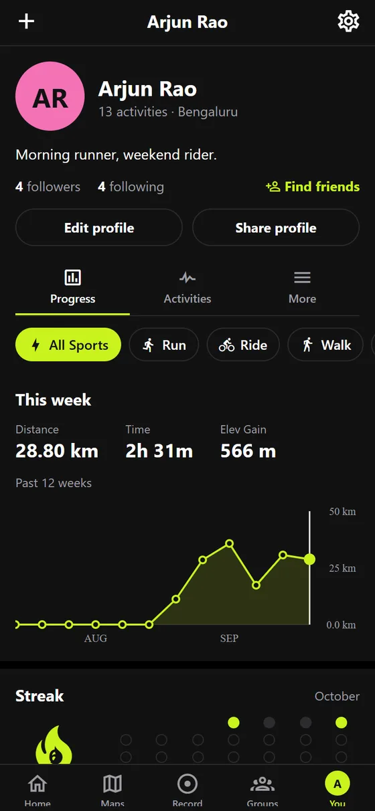
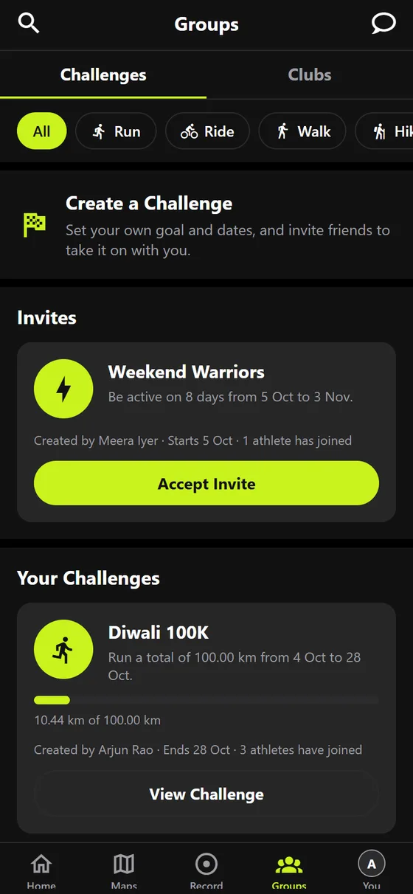
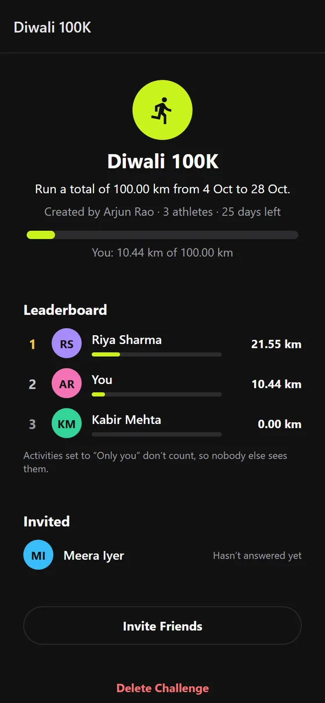
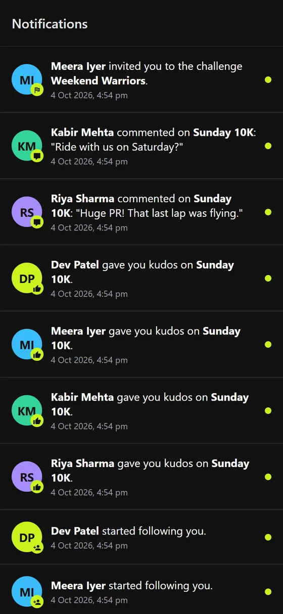
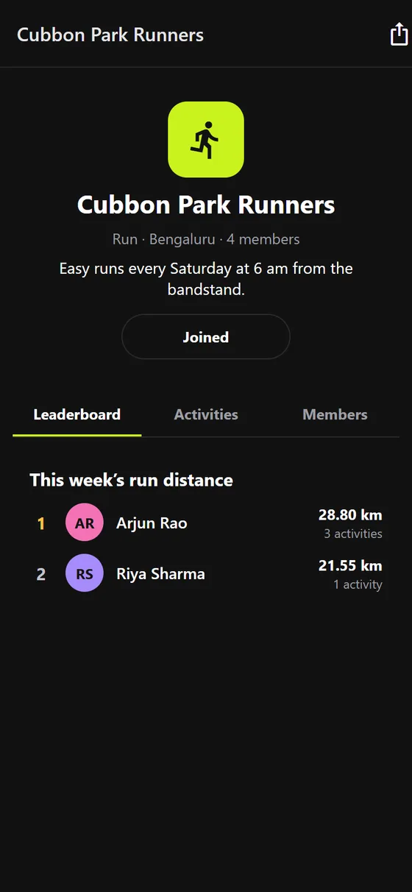
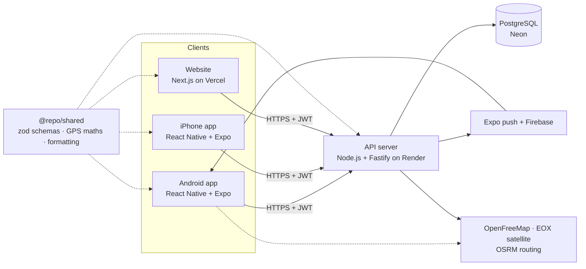

<div align="center">

<picture>
  <source media="(prefers-color-scheme: dark)" srcset="brand/stride-logo-on-dark.svg">
  
</picture>

### A free, private fitness tracker for running, cycling, walking and hiking

Record activities with GPS, follow friends, join challenges and clubs, and see your progress,
on Android, iPhone and the web.

**[Website](https://stride-amanswamy.vercel.app)** · **[Open the web app](https://stride-amanswamy.vercel.app/app)** · **[Download for Android](https://stride-amanswamy.vercel.app/download)** · [Privacy policy](https://stride-api-sa5e.onrender.com/privacy)


</div>

---

<table>
  <tr>
    <td align="center"><br><sub>Progress and streaks</sub></td>
    <td align="center"><br><sub>Challenges</sub></td>
    <td align="center"><br><sub>Leaderboards</sub></td>
    <td align="center"><br><sub>Notifications</sub></td>
    <td align="center"><br><sub>Clubs</sub></td>
  </tr>
</table>

<sub>Real screens from the Android app, shown with sample people and activities.</sub>

## About

Stride is a full-stack fitness app in the style of Strava, built from scratch as a 3rd-year
project and used by real people. One codebase gives an **Android app**, an **iPhone app**, a
**web app** that installs from Safari or Chrome, a **website** and a **backend server**. All of them
share the same rules for data and GPS maths.

Three ideas shaped it:

- **Free, always.** No ads and no subscription. Creating your own group challenges, planning
  routes, heatmaps and satellite maps are all included. It runs entirely on free services.
- **Private by default.** New activities are visible to followers only, the start and end of
  every route are hidden from others, and there are no trackers. Your data is never sold.
- **Numbers you can trust.** The phone sends raw GPS points, and the server works out the
  distance, pace, splits and records itself, so every screen shows the same, honest numbers.

## Features

| | |
|---|---|
| **GPS recording** | Runs, rides, walks and hikes, each with its own live stats and voice updates. GPS glitch filtering, moving time that ignores stops, and an offline outbox so a run recorded without signal is never lost. |
| **Activity analysis** | Splits, elevation profile, best efforts (400 m to marathon for runs, 5K to 100K for rides), personal records with 2nd and 3rd place, and achievements. |
| **Progress** | Weekly totals, a 12-week chart, weekly goal, streak calendar and a trophy case. |
| **Friends** | Follow people, a home feed, kudos, comments, private messages, "Who to Follow", and adding friends by QR code. |
| **Challenges** | New challenges every month, plus **your own challenges** with any goal and dates, invites and a live leaderboard. |
| **Clubs** | Groups for a sport and a place, with a weekly distance leaderboard. |
| **Maps** | All your routes on one map, suggested routes, routes you draw yourself, personal and shared heatmaps, and Standard, Dark and Satellite maps. |
| **Notifications** | Follows, kudos, comments, challenge invites and messages, in the app and as push notifications on Android. Tapping one opens what it's about. |
| **Safety** | Who-can-see per activity (Everyone, Followers, Only you), a 200 m privacy zone, blocking and reporting, and account deletion that erases everything. |
| **Web app** | The whole app in Safari or Chrome at [/app](https://stride-amanswamy.vercel.app/app): recording with GPS, maps, friends, challenges and clubs. Add it to the Home Screen and it opens full screen with its own icon, and still opens with no signal. |
| **Website** | Log in to see your activities, routes and stats on a bigger screen, and download the Android app. |

## How it's built



| Layer | Technology |
|---|---|
| Mobile | React Native 0.86, Expo SDK 57, Expo Router, MapLibre (Android), Apple Maps (iPhone), expo-location, expo-notifications |
| Website | Next.js 16, React 19, Tailwind CSS 4 |
| Backend | Node.js, Fastify 5, PostgreSQL (`pg`), zod 4, JWT auth, scrypt password hashing |
| Shared | One TypeScript package of zod schemas, GPS maths and formatting, used by all three apps |
| Testing | Vitest, PGlite (Postgres running in memory) for end-to-end API tests |
| Hosting and ops | Render (API), Neon (database), Vercel (website), Expo EAS (builds and over-the-air updates), GitHub Actions (CI, backups, uptime) |

**In numbers:** 147 automated tests · about 75 API endpoints · 22 database tables · 11 migrations ·
₹0 a month to run.

## Engineering highlights

- **The server is the source of truth for stats.** The app uploads raw GPS points. The server
  drops impossible jumps (speed limits per sport), separates moving time from stops, and works
  out splits, climbing, best efforts and records
  ([`geo.ts`](packages/shared/src/geo.ts), [`analysis.ts`](packages/shared/src/analysis.ts)).
- **One set of rules everywhere.** The same zod schemas check input on the phone, the website
  and the server, so the three can't disagree about what's valid
  ([`packages/shared`](packages/shared/src)).
- **Offline-first recording.** Finished activities wait in an on-phone outbox until they upload.
  Each one carries a client ID and the database has a unique index on it, so a retried upload
  never creates a duplicate ([`pending-activities.ts`](apps/mobile/src/lib/pending-activities.ts)).
- **Privacy enforced on the server.** Visibility and two-way blocks are part of every query that
  returns someone else's data ([`activity-sql.ts`](apps/api/src/activity-sql.ts)). The first and
  last 200 m of a route are cut off before it leaves the server
  ([`hideEnds`](packages/shared/src/geo.ts)).
- **Heatmaps drawn by the server.** Map tiles are drawn from everyone's routes as PNG images
  (with a small built-in PNG encoder), with no paid map service
  ([`heatmap.ts`](apps/api/src/heatmap.ts)).
- **Handles phones with the wrong clock.** Uploads carry the phone's time, and the server shifts
  activities onto real time when the phone's clock is wrong
  ([`clock-fix.ts`](apps/api/src/clock-fix.ts)).
- **Push notifications that respect privacy.** They are never sent between blocked people, they
  stop after logout, and dead phones are removed automatically ([`push.ts`](apps/api/src/push.ts)).
- **Security basics done properly.** Salted scrypt password hashes, JWTs that are revoked on
  password change, rate limits per visitor and per account, every request validated, and
  password reset by emailed code.
- **Run like a real service.** CI on every push, encrypted weekly database backups, an hourly
  uptime check, crash and error reports, and Dependabot security updates.

## Tests

```bash
npm test     # all 147 tests, about 30 seconds
```

| Suite | What it covers |
|---|---|
| [`apps/api/test`](apps/api/test) | The server end to end, against a real Postgres: sign-up, login, password reset, recording activities (distance, records, GPS glitches, duplicate uploads), who can see what, the privacy zone, follows, feed, kudos, comments, blocking, reports, messages, clubs, challenges, stats, routes, heatmaps and push notifications |
| [`packages/shared/test`](packages/shared/test) | GPS distance, glitch removal, climbing, splits, best efforts, achievements, the privacy zone, formatting and form checks |
| [`apps/mobile/test`](apps/mobile/test) | The offline outbox, push sign-up and logout, dates in the phone's own time zone, map types and stats on cards |

The API tests start a throwaway Postgres in memory (PGlite) and run the real migrations on it.
They refuse to run against anything except this computer, so they can never touch the live
database. GitHub Actions runs type checks, all tests and lint on every push
([`ci.yml`](.github/workflows/ci.yml)).

## Project structure

```
apps/
  mobile/     Android and iPhone app (React Native + Expo Router)
  web/        Website (Next.js)
  api/        Backend server (Fastify + PostgreSQL), with SQL migrations
packages/
  shared/     Schemas, GPS maths and formatting used by all three apps
brand/        Logo and icon files
.github/      CI and uptime checks (backups run in a separate private repo)
```

## Running it locally

You need Node.js 22+ and a free [Neon](https://neon.tech) Postgres database.

```bash
npm install
cp apps/api/.env.example apps/api/.env   # add DATABASE_URL and a random JWT_SECRET
npm run db:migrate                       # create the tables

npm run dev:api       # API      → http://localhost:4000
npm run dev:web       # website  → http://localhost:3000
npm run dev:mobile    # app      → scan the QR code with Expo Go
```

The phone and computer need to be on the same Wi-Fi. If the app can't reach the server, check
the "Server" address at the bottom of the **You** tab, and allow Node.js through the firewall on
private networks. To check layouts without a phone, run `npx expo start --web` in `apps/mobile`
(maps only draw on a real phone).

## Roadmap

- [x] Accounts, GPS recording, activity analysis, personal records and achievements
- [x] Maps: route suggestions, drawing routes, heatmaps, Standard, Dark and Satellite maps
- [x] Friends: follows, feed, kudos, comments, messages, notifications, clubs
- [x] Monthly challenges and your own challenges with invites and leaderboards
- [x] Push notifications, progress charts, goals and streaks
- [x] Automated tests, CI, backups, uptime monitoring, website and Android download page
- [x] Web app for iPhone and Android browsers, installable from the Home Screen
- [ ] Google Play and App Store listings
- [ ] Background GPS recording (screen off)
- [ ] Photos on activities
- [ ] Segments with leaderboards

## Author

Built by **Aman Swamy** ([@Amann001](https://github.com/Amann001)).

---

<details>
<summary><b>Owner notes: deploying, operations and gotchas</b></summary>

### Where it runs

| Part | Where |
|---|---|
| Database | Neon (Singapore) |
| API | Render, `https://stride-api-sa5e.onrender.com` (free plan, Singapore). Redeploys on every push to `main` and runs new migrations on start. Config: [`render.yaml`](render.yaml) |
| Website | Vercel, https://stride-amanswamy.vercel.app (project `stride-app`, folder `apps/web`). `NEXT_PUBLIC_API_URL` is set in the Vercel project settings |
| Web app | Same Vercel project, at `/app`. Every website build first builds the app (`apps/mobile`) for browsers into `apps/web/public/app` ([`build-web-app.mjs`](apps/web/scripts/build-web-app.mjs)); if that fails, Vercel keeps the previous version online. Browser-only code lives in `*.web.tsx` / `*.web.ts` files, which the phone apps never include |
| Android app | APK built on Expo EAS. The current download link and version live in [`apps/web/src/lib/android-app.ts`](apps/web/src/lib/android-app.ts) |
| iPhone app | Expo Go, loading the `production` update channel |

Render's free plan sleeps after 15 minutes without use, so the first request after a break can
take up to a minute.

### Releasing

- **App changes** (most changes): commit, then `npm run publish:app`. This sends an over-the-air
  update to iPhone (Expo Go) and Android.
- **Native changes** (new native packages, permissions, icons): bump `version` in
  `apps/mobile/app.json` (the runtime version follows the app version), then
  `npm run build:android`. Paste the new APK link and version into `android-app.ts`, writing the
  size as plain digits, and publish an update.
- The published app gets its API address from `EXPO_PUBLIC_API_URL` in the EAS `production`
  environment (not from `.env.production`, which only local `expo export` uses).
- `ios.runtimeVersion` is `exposdk:57.0.0` so Expo Go can load the update. When Expo Go moves to
  a new SDK, run `npx expo install expo@latest --fix` and update it. For an App Store build,
  switch it to `{ "policy": "appVersion" }`.
- To open the iPhone app on any network, open this link in Expo Go while signed in as the
  project owner:
  `exp://u.expo.dev/4e419f43-5433-41ca-be3d-8ac8867a9622?runtime-version=exposdk%3A57.0.0&channel-name=production`

### Weekly checks

- `npm run ops` shows open reports and the last week's crashes and errors. Mark a report done
  with `npm run ops -- reviewed <id>` (or `actioned`).
- **Backups:** every Sunday the private repo `Amann001/stride-backups` saves an encrypted copy of
  the database, kept for 90 days. They live there, not here, so no user data (not even
  encrypted) is ever downloadable from this public repo. To make one now: that repo → Actions →
  Database backup → Run workflow.
- **Uptime:** every hour GitHub checks the server ([`uptime.yml`](.github/workflows/uptime.yml))
  and emails you if it's down.
- **Security updates:** Dependabot alerts and weekly update pull requests
  ([`dependabot.yml`](.github/dependabot.yml)). Upgrade Expo and React Native packages together
  with `npx expo install --fix`.

### Restoring a backup

You need `BACKUP_PASSPHRASE` from `apps/api/.env`, GnuPG and Postgres 18's `pg_restore`.

```bash
gh run download --repo Amann001/stride-backups --name stride-database-<number>
gpg --decrypt --output stride.dump stride.dump.gpg
pg_restore --clean --if-exists --no-owner --dbname "<DATABASE_URL>" stride.dump
```

Restoring replaces the current data, so try it on a new Neon branch first.

### Push notifications

The server sends pushes through Expo's free push service ([`push.ts`](apps/api/src/push.ts)).
Phones register at `PUT /me/push-token` after login and unregister at logout. Android needs
Firebase: `apps/mobile/google-services.json` is in the app, and the Firebase service account key
is uploaded to expo.dev → Credentials → Android → FCM V1. **Never commit that key.** Expo Go
on iPhone can't receive push, so there notifications stay in the in-app list.

### Email (password reset)

Render's free plan blocks SMTP ports, so email goes through **Brevo's web API** (free, 300 a
day). On Render set `BREVO_API_KEY` and `MAIL_FROM` = `Stride <stride.supportteam@gmail.com>`
(the sender must be verified in Brevo). On other hosting, SMTP works instead: `SMTP_HOST`,
`SMTP_PORT`, `SMTP_USER`, `SMTP_PASS`. Failed sends show up in `npm run ops`.

### Privacy and safety details

- The privacy zone (`hideEnds` in [`geo.ts`](packages/shared/src/geo.ts)) applies to maps, feed,
  clubs, activity pages and shared heatmaps.
- Blocks apply both ways everywhere (`noBlockBetween` in
  [`activity-sql.ts`](apps/api/src/activity-sql.ts)).
- Rate limits: [`rate-limits.ts`](apps/api/src/rate-limits.ts). Changing a password logs out
  every other device (token version).
- Crash reports and server errors go to the `error_reports` table with no personal data. Logs
  never contain the heatmap access key.
- The privacy policy and terms are served by the API at `/privacy` and `/terms`
  ([`legal.ts`](apps/api/src/routes/legal.ts)). Set `CONTACT_EMAIL` on Render to show a
  contact address. Update them whenever the app starts collecting something new.

### Code gotchas

- What each activity type measures (live stats, voice update distance, best efforts) lives in
  [`categories.ts`](packages/shared/src/categories.ts).
- Each map component has an `.android.tsx` twin (MapLibre) next to the iPhone version (Apple
  Maps): `route-map`, `maps-tab-map`, `create-route-map`. Keep both in step.
- Android maps use free OpenFreeMap styles. Satellite uses EOxCloudless **2016** (CC BY 4.0;
  later years are non-commercial only), and its credit must stay visible.
- Don't format dates with `toLocaleString` in the app: Hermes on Android can't be trusted with
  time zones. Use [`lib/dates.ts`](apps/mobile/src/lib/dates.ts).
- Android has no `Alert.prompt`; use `promptText()` from `components/text-prompt.tsx`.
- After pulling new code, run `npm run db:migrate`. It adds new tables and columns, and fills in
  data for older activities.
- GPS records while the app is open (no background tracking yet), so the Record screen keeps
  the screen on.

</details>
